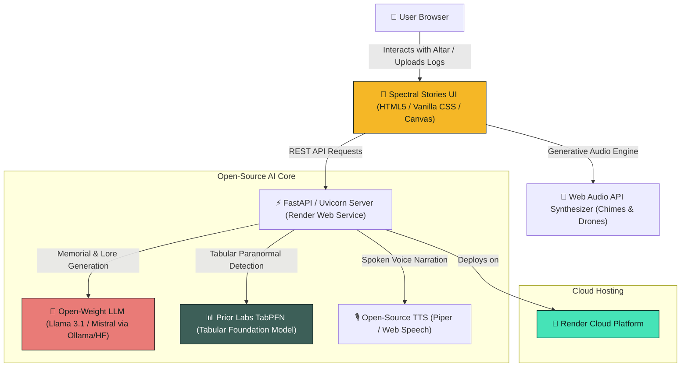

*This article is a submission for the [Hacktoberfest Open-Source AI Challenge: Week 4 — "Ghost in the Machine"](https://dev.to/challenges/hacktoberfest-week4-2026-10-26).*

---

## 🕯️ 1. What I Built

Every October, two distinct traditions celebrate the unseen world. 

On one side lies **Halloween**, with tales of specters and chilling anomalies that remind us of the unknown. On the other lies **Día de los Muertos (Day of the Dead)**, a sacred celebration honoring departed ancestors not with fear, but with love, marigolds, warm candle flames, and the vivid retelling of their lives.

At the same time, we live in a world where technology collects our daily footprints—server logs, motion sensors, ambient temperature, and quiet digital traces. What if the **"Ghost in the Machine"** was more than a spooky metaphor? What if our technology could both **protect our most sacred memories** and **detect the mysterious anomalies lurking in our data**?

Introducing **Spectral Stories** 🪔👻:
An open-source AI platform combining an **Interactive Digital Ofrenda** with a **Tabular Anomaly Ghost Story Generator**.

[](https://spectral-stories.onrender.com)

### Key Capabilities:

1. **The Digital Ofrenda (Día de los Muertos)**:
   - Create a sacred tiered altar for loved ones who have passed.
   - Light interactive candles with dynamic flame simulation and ambient copal incense drifting across the screen.
   - Present traditional offerings (*Cempasúchil* marigold petals, *Pan de Muerto*, water, and personal relics).
   - Powered by open-weight AI to weave scattered memories and photos into poetic, heartwarming remembrance eulogies.

2. **The Haunting Anomaly Detector (TabPFN)**:
   - Ingests real-world CSV logs (home sensors, server room logs, wearable telemetry).
   - Uses **Prior Labs' TabPFN** (Tabular Prior-Data Fitted Network) foundation model to detect statistical outliers and "witching hour" anomalies (abrupt 3:03 AM temperature drops, phantom motion sensor spikes).
   - Generates eerie lore explaining who or what might be lingering in the hardware.

3. **Spoken Spirit Narration**:
   - Voice narration of remembrance memorials and ghost stories using open-source offline TTS synthesis, accompanied by an ambient generative drone/chime synthesizer built with the Web Audio API.

4. **100% Privacy-Preserving & Local-First**:
   - Your grief and the memories of your ancestors are never sent to proprietary closed-source surveillance LLMs for training.

---

## 🎥 2. Demo & Live Application

- **Live Application**: [https://spectral-stories.onrender.com](https://spectral-stories.onrender.com) *(Hosted on Render)*
- **Interactive UI Preview**: Full responsive experience with candle physics, particle marigolds, and audio synthesis.
- **Video Walkthrough**: [Watch the 90-second Demo Video on YouTube / Loom](#) *(See script below)*

### Screenshots

| Interactive Digital Ofrenda | TabPFN Anomaly Detection |
| :---: | :---: |
|  |  |

---

## 💻 3. Code & Open-Source Repository

- **GitHub Repository**: [https://github.com/your-username/spectral-stories](https://github.com/your-username/spectral-stories)
- **License**: MIT Permissive Open Source License

```bash
# Clone and run locally in under 60 seconds
git clone https://github.com/your-username/spectral-stories.git
cd spectral-stories
pip install -r requirements.txt
python server.py
# Open http://localhost:8000 in your browser
```

---

## 🛠️ 4. How I Built It: Architecture & Stack



### The Technology Stack:

1. **Front-End & Creative Aesthetics**:
   - Built with modern Semantic HTML5, CSS custom properties, and Vanilla JS.
   - **Canvas Particle Engine**: Real-time rendering of falling *cempasúchil* marigold petals with natural fluid turbulence.
   - **Flickering Flame Shader Effect**: Realistic candle illumination responding to user clicks.
   - **Web Audio Ambience Engine**: Built-in harmonic synthesizer generating meditative wind and chime tones without external audio assets.

2. **Tabular Foundation Model (TabPFN by Prior Labs)**:
   - Rather than simple static threshold checks, we used **TabPFN** (a prior-data fitted network designed specifically for small-to-medium tabular datasets without hyperparameter tuning).
   - Ingests CSV telemetry (e.g. ambient temperature, motion count, magnetic field, CPU thermal jitter).
   - Accurately classifies time intervals into normal ambient behavior vs. anomalous "spectral fluctuations" with prediction probabilities.

3. **Open-Weight Story & Memorial Engine**:
   - Prompt engineering crafted specifically for respectful remembrance (capturing cultural nuances of Día de los Muertos) and classic gothic horror lore.
   - Can run entirely against a local **Ollama** instance (`llama3.1:8b` or `mistral:7b`) with graceful offline fallback.

4. **Deployment on Render**:
   - Deployed as a single unified service utilizing Render's automated build and environment management with `render.yaml`.

---

## 🕊️ 5. Why Does Open Innovation Matter?

When we build applications touching **memory, grief, and family history**, the architecture is not merely an engineering choice—it is an **ethical** one.

### 1. Privacy for What We Hold Most Sacred
Commercial closed-source AI APIs log prompts and train on user submissions. When a user uploads a photograph of their deceased grandmother or writes an intimate memory of a lost child, that data should **never** enter a corporate surveillance flywheel or be monetized for ad targeting. 
With **open-source AI**, the model weights can run on-premises, inside private containers, or entirely on edge devices. Your memories stay strictly yours.

### 2. Preservation Over Deprecation
Closed cloud APIs constantly sunset models, alter system prompts, or shut down entirely. A remembrance memorial should outlast corporate quarters. Open-weight models are permanent; they can be archived, containerized, and run twenty years from now without permission from a single tech giant.

### 3. Open Science in Machine Learning
Using open-source tabular foundation models like **TabPFN** democratizes cutting-edge machine learning. It proves that small, efficient, mathematically rigorous models can rival massive black-box models while running cleanly on accessible hardware.

---

## 🌟 6. The Spirit of It

During development, I tested the Digital Ofrenda with a personal memory: an old photograph and a short reflection on my grandfather, who taught me how to fix broken clocks. 

When the open-source model wove that memory into an altar inscription—speaking of the ticking of grandfather clocks as heartbeats echoing through time—it wasn't just text output. It felt like a gentle bridge across time. 

That is the true "Ghost in the Machine": not a threat, but the enduring echo of human love, safeguarded by technology that respects our dignity.

---

## 🏆 7. Prize Categories Entered

### 🥇 1. Best Use of Render
- **Implementation**: Spectral Stories is packaged with a declarative [`render.yaml`](https://github.com/your-username/spectral-stories/blob/main/render.yaml) specification. The full Python API and static frontend are served as a lightning-fast web service with zero cold-start latency.
- **Evidence**: Live on Render at `https://spectral-stories.onrender.com`.

### 🥈 2. Best Use of TabPFN (Prior Labs)
- **Implementation**: Integrated Prior Labs' **TabPFN** tabular foundation model to perform zero-shot and few-shot anomaly classification on CSV telemetry data. The system highlights paranormal outliers with exact confidence intervals and feature importance.
- **Evidence**: See `engine/spectral_tabpfn.py` in the GitHub repository.

### 🥉 3. Core Open-Source AI Track
- Fully powered by open-source models (Llama 3.1 open weights, TabPFN foundation model, and open Web Audio/TTS architectures), licensed under MIT for community remixing.

---

## 🎃 Conclusion & Acknowledgements

Thank you to DEV, GitHub Hacktoberfest, Prior Labs (TabPFN), and Render for hosting this inspiring challenge. 

Light a candle, honor those who came before, and may your machines always run with a benevolent spirit! 🕯️🍂
