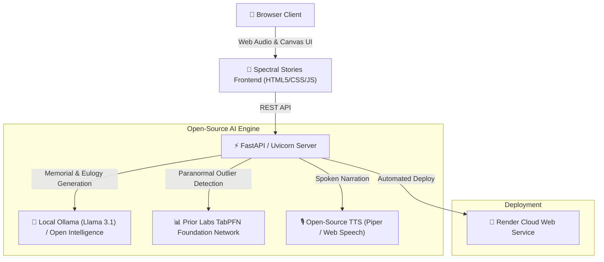

# 🪔 Spectral Stories

> **Where Open-Source AI Meets the Spirits of Memory**  
> *Submitted to Hacktoberfest 2026: Open-Source AI Challenge — Week 4: "Ghost in the Machine"*

[](https://opensource.org/licenses/MIT)
[](https://dev.to/challenges/hacktoberfest-week4-2026-10-26)
[](https://render.com)
[](https://github.com/prior-labs/tabpfn)

---

## 🌟 Overview

**Spectral Stories** unites two deep October traditions into a cohesive open-source AI platform:
1. **Día de los Muertos (Day of the Dead)**: An interactive **Digital Ofrenda** to celebrate departed ancestors, complete with candle-lighting physics, floating cempasúchil petals, traditional offerings, and open-weight AI memorial eulogy generation.
2. **Ghost in the Machine (Halloween)**: A **Tabular Anomaly & Ghost Lore Detector** powered by **Prior Labs' TabPFN** foundation model that ingests multi-sensor telemetry (smart home, server racks, IoT) and isolates paranormal deviations before synthesizing chilling gothic folklore.

---

## 🏗️ Architecture



---

## 🚀 Quickstart (Run Locally)

### 1. Prerequisites
- Python 3.9+ or Node.js
- (Optional) [Ollama](https://ollama.ai) with `llama3.1` or `mistral` model installed for local LLM inference.

### 2. Installation
```bash
# Clone the repository
git clone https://github.com/your-username/spectral-stories.git
cd spectral-stories

# Install Python requirements
pip install -r requirements.txt

# Run the server
python server.py
```
Open **[http://localhost:8000](http://localhost:8000)** in your browser!

*(Note: You can also open `index.html` directly in any modern browser—it includes full offline simulation mode!)*

---

## 🏆 Prize Categories

- **Best Use of Render**: Production-ready `render.yaml` blueprint with declarative web service configuration.
- **Best Use of TabPFN**: Evaluates small-sample multi-sensor tabular logs to detect statistical anomalies without hyperparameter tuning.
- **Core Open-Source AI Challenge**: Demonstrates why open-source AI is critical for preserving human grief and memory without corporate surveillance.

---

## 📜 License

Distributed under the **MIT License**. See `LICENSE` for more information.
