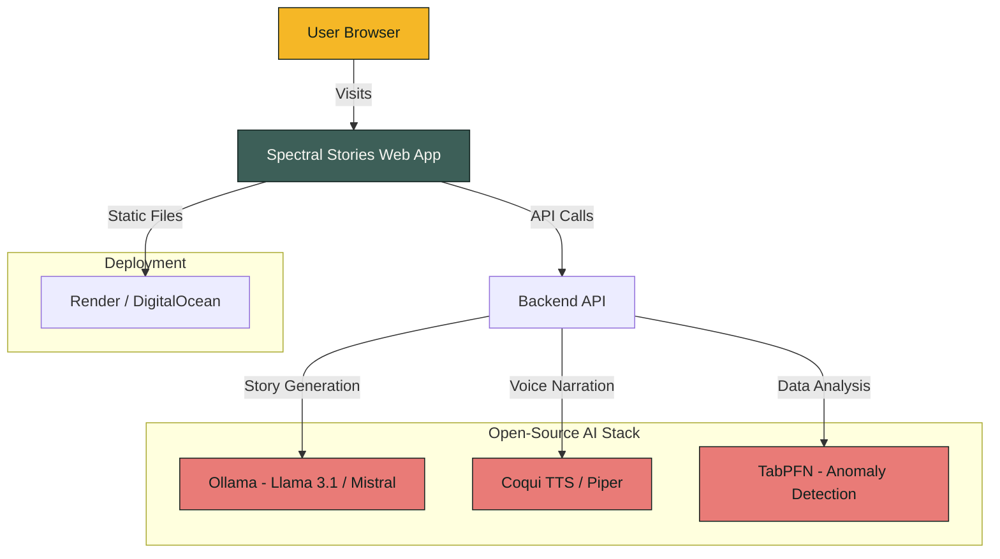

# 🎃 Hacktoberfest 2026 — Week 4: "Ghost in the Machine"
## Implementation Plan to Win

---

> [!IMPORTANT]
> **Deadline: October 31, 2026** (Halloween night!) — **~3 days left**
> Winners announced: Week of November 2

---

## 📋 Challenge Summary

| Field | Details |
|---|---|
| **Challenge** | Hacktoberfest Open-Source AI Challenge: Week 4 |
| **Theme** | **Ghost in the Machine** — Build something spooky, or something that honors the past in the spirit of Día de los Muertos |
| **Core Requirement** | Build something with **open-source AI at its core** (open-weight models, open-source agent frameworks, local inference) |
| **Top Prize** | **$250 USD** + DEV++ Membership + Winner Badge |
| **Category Prizes** | **$200 USD each** + Winner Badge (20 categories) |
| **Tags** | `devchallenge`, `hf26challenge` |

---

## 🏆 Judging Criteria (in order of weight)

1. **Writing Quality** *(weighted most heavily!)* — The blog post itself matters more than anything
2. **Relevance to the Prompt and Theme** — How well does it tie to "Ghost in the Machine" / Día de los Muertos / spooky / honoring the past?
3. **Creativity** — Unique interpretations win
4. **Technical Execution** — Quality of the code and architecture
5. **Use of Partner Technology** *(optional)* — Entering prize categories boosts visibility

---

## 🎯 Prize Categories Available

### Featured Categories ($200 each)
| Category | What They Want |
|---|---|
| **Best Use of Render** | Use Render as your AI runtime, host a front end, or run Hermes/OpenClaw |
| **Best Use of TabPFN** | Use Prior Labs' TabPFN (tabular foundation model) to forecast/predict/classify from CSV data. Build a prediction agent |
| **Best Use of Tinker** | Use Thinking Machines' Tinker to fine-tune a model; show improvement over baseline |
| **Best Use of Arduino** | Build with Arduino UNO Q — run a model on-board, build a physical agent |
| **Best Use of DigitalOcean** | Deploy on DigitalOcean |

> [!NOTE]
> Additional categories likely include Backboard, .tech domains, and others. You can enter **multiple** categories with a single submission.

---

## 💡 Project Concept: **"Spectral Stories" — An AI-Powered Digital Ofrenda & Ghost Story Generator**

### The Vision
A web app that blends **Día de los Muertos** remembrance with **Halloween spookiness**. Users can:

1. **Create a digital ofrenda** (altar) to honor someone they've lost — uploading a photo, writing a memory, and letting AI weave their stories into a beautiful memorial
2. **Generate ghost stories** based on real data (sensor logs, location history, or text input) — the "ghost in the machine" literally haunts your data
3. **Hear the spirits speak** — text-to-speech narration of stories using open-source TTS models

### Why This Concept Wins

| Criteria | How We Nail It |
|---|---|
| **Writing Quality** | The ofrenda theme is deeply human and emotional — perfect for a compelling blog post |
| **Theme Relevance** | Directly addresses both Halloween AND Día de los Muertos, plus "Ghost in the Machine" |
| **Creativity** | Unique blend of memorial/remembrance + spooky AI generation — not just another chatbot |
| **Technical Execution** | Open-weight LLM + TTS + beautiful UI = impressive stack |
| **Open Innovation** | Everything runs on open models — privacy matters when handling memories of loved ones |

---

## 🏗️ Technical Architecture



### Tech Stack

| Layer | Technology | Why |
|---|---|---|
| **Frontend** | HTML/CSS/JS (Vanilla + modern CSS) | Fast, no framework overhead, stunning visuals with CSS animations |
| **Backend** | Node.js / Python (Flask) | Simple API layer |
| **LLM** | **Ollama** running **Llama 3.1 8B** or **Mistral 7B** | Open-weight, runs locally, privacy-first |
| **TTS** | **Piper TTS** (open-source) | Spooky voice narration, fully offline |
| **Tabular AI** | **TabPFN** by Prior Labs | Anomaly detection on "haunted" data → prize category |
| **Deployment** | **Render** | Free tier, easy deploy → prize category |

---

## 📝 Implementation Phases

### Phase 1: Core App (Day 1 — Today)
- [ ] Set up project structure (HTML/CSS/JS)
- [ ] Build the **Digital Ofrenda UI** — gorgeous, candlelit aesthetic with marigold colors (#f5b726), dark greens (#3d5f58), soft warm tones
- [ ] Implement the memorial form (name, relationship, memory text, photo upload)
- [ ] CSS animations: flickering candles, floating marigold petals, glowing text

### Phase 2: AI Integration (Day 2)
- [ ] Set up **Ollama** with Llama 3.1 or Mistral
- [ ] Build the **story generation API** — takes a memory/data input, generates either:
  - A beautiful remembrance piece (Día de los Muertos mode)
  - A spooky ghost story (Halloween mode)
- [ ] Integrate **TabPFN** for "anomaly detection" on user-provided CSV data (e.g., "your home sensor data reveals something moved at 3:00 AM...")
- [ ] Add **Piper TTS** for ghostly narration of generated stories

### Phase 3: Polish & Deploy (Day 3)
- [ ] Deploy to **Render** (static site + API)
- [ ] Add micro-animations, sound effects, and visual polish
- [ ] Create the GitHub repo with MIT license, clear README
- [ ] Record a demo video / take screenshots

### Phase 4: Write the Submission Post (Day 3)
- [ ] Write a compelling DEV post following the template
- [ ] Focus heavily on **writing quality** (it's weighted most!)
- [ ] Include architecture diagram (Mermaid)
- [ ] Explain why open-source AI matters for this project (privacy of memories!)
- [ ] List prize categories entered

---

## 📰 Submission Post Structure

```markdown
---
title: "Spectral Stories: Where AI Meets the Spirits of Memory"
published: true
tags: devchallenge, hf26challenge
---

*This is a submission for the Hacktoberfest Open-Source AI Challenge Week 4: Ghost in the Machine*

## What I Built
<!-- Emotional hook: the intersection of technology and memory -->

## Demo
<!-- Live link on Render + video demo -->

## Code
<!-- GitHub embed -->

## How I Built It
<!-- Open-source AI stack: Ollama + Llama 3.1, Piper TTS, TabPFN -->

## Why Does Open Innovation Matter?
<!-- Privacy of memories, offline capability, no vendor lock-in for something so personal -->

## The Spirit of It
<!-- The emotional moment — did it bring back a memory? -->

## Prize Categories
- Best Use of Render
- Best Use of TabPFN
```

---

## 🔑 Key Strategies for Winning

> [!TIP]
> ### The #1 Secret: Writing Quality is King
> The blog post is weighted MORE than the code. Write something that makes judges *feel* something. The Día de los Muertos angle gives you a rich, emotional narrative that most technical posts won't have.

1. **Tell a story, not a tutorial** — Open with why this matters to you personally
2. **Beautiful screenshots** — The ofrenda UI should look stunning in the post
3. **Show the "why open-source"** — Privacy of loved ones' memories is a killer argument
4. **Enter multiple prize categories** — Render + TabPFN = 2 extra chances to win
5. **Keep scope tight** — A polished small project beats an unfinished ambitious one

---

## ⏰ Timeline

| When | What |
|---|---|
| **Oct 28 (Today)** | Set up project, build UI, start AI integration |
| **Oct 29** | Complete AI features, deploy to Render |
| **Oct 30** | Polish, record demo, write blog post |
| **Oct 31 (Deadline)** | Final review, publish submission on DEV |

---

> [!CAUTION]
> **Don't forget:**
> - Tags must be exactly `devchallenge` and `hf26challenge`
> - Must use the submission template from the challenge page
> - Open-source AI must be **at the core** of the project (not a side feature)
> - Code must be in a public GitHub repo with a permissive license (MIT/Apache 2.0)
